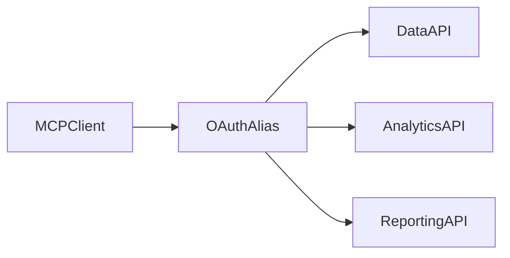

# YouTube Manager MCP

**Inspect channel operations and analytics with explicit identity and coverage.**

[](https://github.com/ashutosh0sharma1/youtube-manager-mcp/actions/workflows/ci.yml)

## What you can do

Pinned OAuth aliases, paginated uploads, retention, Reporting API, weighted CTR, video operations and local Shorts previews.

## How it works



## Quick start

```sh
npm ci
cp .env.example .env
npm run build
node dist/index.js
```

## Verify

```sh
npm test
npm run typecheck
```

[VALIDATION.md](VALIDATION.md) records checks actually run against this export and their limits.

## Boundaries

Supply a Google OAuth desktop client and enable required APIs. Tokens under .youtube-mcp stay private. Some tools write to channels; review agent actions. Shorts need FFmpeg/yt-dlp and licensed media. API coverage can be incomplete.

## Contribute

Start with a small synthetic reproduction. Improvements to portable setup, failure recovery, documentation and regression coverage are welcome. Read [CONTRIBUTING.md](CONTRIBUTING.md) before opening a pull request.

## License and provenance

See [LICENSE](LICENSE) and [THIRD_PARTY_NOTICES.md](THIRD_PARTY_NOTICES.md). This clean source export excludes private data, credentials and development history.

## Connect a channel

Run the built server over stdio through your MCP client, with this checkout as its working directory. Configure a Google OAuth desktop client locally using `.env.example`; the server stores tokens under ignored `.youtube-mcp/` paths.

1. Call `authorize_channel` with a descriptive `channel_alias` and, when known, `expected_channel_id`.
2. Complete the displayed consent flow yourself, then verify `list_channels` and `get_channel`.
3. Use `list_uploads` for paginated inventory and the analytics/reporting tools for date-bounded analysis. Coverage and missing metrics must remain visible.
4. Review channel identity before write tools. Revenue scopes are opt-in.

The Shorts pipeline separates selection, loop tests, preview, approval, final render and private-upload preparation. Preview or render approval does not publish a video. Use only source media you have permission to reuse. The `scripts/shorts` folder contains reusable ranking/cost/validation helpers; editorial campaign batches are excluded.

Remotion is an optional rendering dependency with its own license conditions; this repository's MIT license does not replace them.
